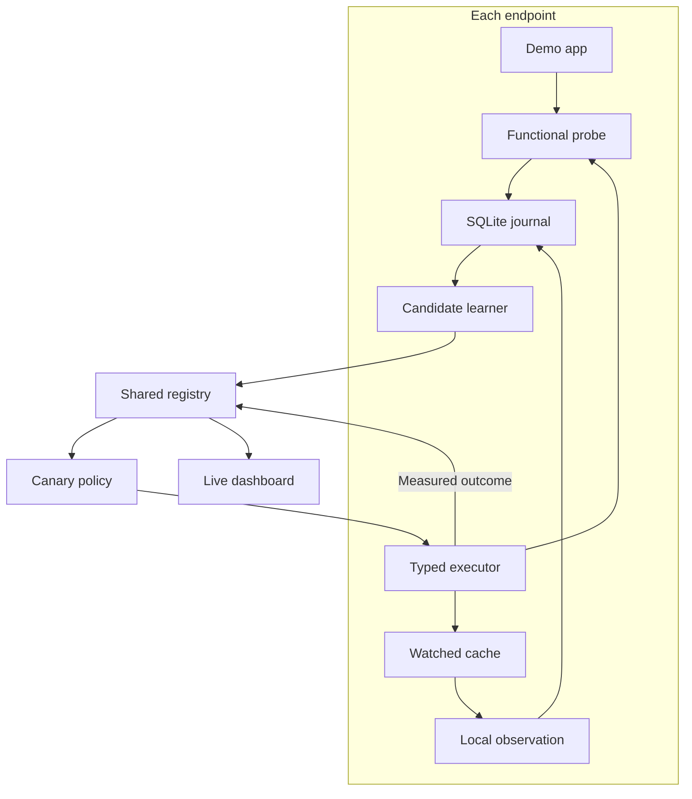

# Architecture

SWARM demonstrates the conversion of one observed local recovery into a reusable, empirically tested repair. It learns an association between an issue and a supported action. It does not establish general causality or synthesize arbitrary system commands.

## Detection and learning

The canonical issue key hashes a schema version, app identity, operation and bounded error code. Versions/platform are kept in applicability metadata. Application logs and cache contents remain local. The current watcher compares cache fingerprints once per tick; it is intentionally app-scoped.

An incident opens only after `/work` fails with the recognized cache error. A candidate requires an observed external cache change after that incident and three successful subsequent operations. Ordinary silence or process liveness cannot count as recovery. SWARM's own repairs update the observation baseline so they cannot become new independent human discoveries.

The optional local-model adapter narrates this evidence. It cannot alter the action type, issue identity, rollout permissions or verification outcome. Invalid output falls back to a labelled deterministic explanation. A future investigator can collect extra evidence through typed read-only tools without changing the executor's trust boundary.

## Execution and verification

Recipes contain an allowlisted action ID, an exact environment, originating evidence IDs and a revision. They contain no executable scripts or arbitrary paths. Endpoints recheck the current incident, environment, cache state and failing operation immediately before action.

`quarantine_demo_cache` atomically moves the known cache into a local quarantine directory. The app regenerates absent cache. Three consecutive successful functional operations produce a verified outcome. Failure restores the prior cache and pauses the recipe. Rollback is specific to this action; other action classes need their own implementations.

Demo filesystem helpers reject unmarked nonempty directories, traversal and symlink resources. They are a containment guard for controlled app files, not a general OS sandbox or a defense against an actively malicious privileged local user.

## Coordination and durability

The coordinator uses SQLite transactions to admit one canary per issue/action/environment cohort. Matching followers become eligible only after a verified canary outcome. Incompatible devices receive no assignment. Failed or inconclusive results pause the recipe; global resume does not silently reactivate it.

Assignments have IDs, deadlines and terminal outcomes. Duplicate submissions cannot inflate evidence counts. The local journal claims an attempt before mutation; after response loss it resends the stored outcome rather than applying the action again. An agent interrupted during a repair reports inconclusive instead of blindly repeating it. Inspect its quarantined file when recovering such an interruption.

Assignment timeout defaults to 120 seconds; an unconfirmed canary pauses the recipe. Global pause prevents new work delivery, including pending work not yet picked up. An action already running may finish. This is not instant remote cancellation.

Reset clears shared incidents, recipes and outcomes, retains registrations and queues explicit reset commands. Agents restore only known app resources and clear runtime association state. Local audit observations/quarantine are preserved. Results from old/reset assignments are rejected.

## Transport and identity

HTTP polling is intentionally simple and sufficient for the demo. All API routes can require `X-Swarm-Token`; the CLI requires a token before binding the coordinator to a LAN address. The token authenticates membership in one trusted demo group, not individual device identity. A peer with this token can impersonate another demo peer; per-device credentials, tenant isolation, signed recipes and authenticated outcomes are required before production deployment.

The dashboard and health endpoint are readable without a token; fleet data and mutations are behind API authentication when configured. No raw logs are uploaded, but device labels and environment metadata are still shared with the group.

## Platform boundaries

The shared core consists of wire contracts, evidence storage, issue matching, candidate association, rollout and verification semantics. The current adapter is a controlled app with file operations and HTTP probes that runs natively on macOS/Linux.

A Windows adapter would provide Event Log/WER observations and invoke known PowerShell/Remote Action implementations. A macOS system adapter could add Unified Logging and crash-report ingestion. Neither broad OS integration is implied by the prototype.
