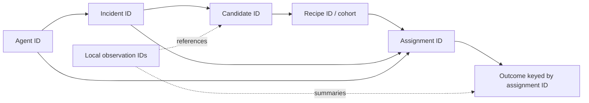

# Data, identifiers and recovery state

[Documentation home](README.md) · [Repair lifecycle](repair-lifecycle.md) · [Operations](operations.md)

SWARM has two independent stores: one coordinator registry for fleet decisions,
and one local journal per endpoint for observation and durable execution. Both
use SQLite with JSON payloads. Their identifiers connect application records;
there are no SQL foreign-key declarations enforcing these relationships.

## Files on disk

A local rehearsal using the default data directory produces this layout:

```text
.swarm/local/
├── coordinator.sqlite
├── logs/                     # Supervisor's child-process output
├── mac-a/
│   ├── .swarm-demo-root
│   ├── journal.sqlite        # Endpoint journal; WAL sidecars may exist
│   ├── cache/workspace.json
│   ├── quarantine/           # Cache files moved by repairs
│   └── logs/app.jsonl        # App operations; app.jsonl.1 after rotation
└── mac-b/, mac-c/, mac-d/     # D exists with --include-incompatible
```

The app/agent may temporarily use `.fail-verification` to trigger the controlled
verification-failure scenario. `swarm node --data-dir ...` uses its chosen
directory as one endpoint root. Coordinator-only defaults differ:
`swarm coordinator` uses `.swarm/coordinator.sqlite`, while `make dev` uses
`.swarm/dev-coordinator.sqlite`. See [configuration](configuration.md).

The marker identifies a SWARM-owned demo directory. The journal's
`owner_agent_id` separately binds that directory to an endpoint identity and
survives reset. Renaming `--id` is not a safe way to reuse an existing directory.

## Coordinator registry

Schema and transactions live in [`Registry`](../src/swarm/registry.py).

| Table | Columns / identity | Purpose |
| --- | --- | --- |
| `agents` | `id` primary key, `data` | Registration plus latest health, incident pointer and heartbeat receipt time |
| `incidents` | `id` primary key, `data` | Historical endpoint issue reports |
| `recipes` | `id` primary key, unique `cohort`, `data` | Shared recipe and mutable rollout state |
| `candidates` | `id` primary key, `recipe_id`, `data` | Proposal deduplication and association with a cohort's recipe |
| `assignments` | `id` primary key, `agent_id`, `incident_id`, `recipe_id`, `data`, `state`, `expires_at` | Immutable assignment snapshot and pending/complete delivery state |
| `outcomes` | `id` primary key, `data` | Terminal result keyed by assignment ID |
| `commands` | `id` primary key, `agent_id`, `data`, nullable `ack` | Demo command delivery and durable acknowledgement |
| `events` | Autoincrement `seq`, `data` | Recent coordinator activity |
| `meta` | `key` primary key, `value` | Global `paused` flag and deduplication markers for incompatible-device events |

`assignments` also has a unique `(agent_id, incident_id, recipe_id)` constraint:
one recipe cannot be assigned twice for the same endpoint incident. The command
agent index and two partial indexes for pending-assignment agent/expiry lookups
keep common polls from scanning completed fleet history.

The registry opens a connection per transaction, sets a 10-second busy timeout,
uses `BEGIN IMMEDIATE`, and commits or rolls back before closing. It does **not**
enable WAL itself. Outcome ingestion uses two transactions so an assignment's
timeout can remain committed even when the subsequent late success conflicts.
Do not describe the fleet as one transaction spanning coordinator and endpoints.

Events are trimmed to the newest 500 when events are written; `/api/state`
returns at most 200. Recipes, candidates, incidents, assignments, outcomes and
acknowledged commands have no general retention policy. A bounded evidence
payload does not imply bounded database size.

## Endpoint journal

Schema and durability helpers live in [`Journal`](../src/swarm/journal.py).
Each endpoint keeps one SQLite connection and explicitly enables WAL mode.

| Table | Columns / identity | Purpose |
| --- | --- | --- |
| `observations` | `id` primary key, `timestamp`, `kind`, `data` | Local audit observations; selected records become bounded shared summaries |
| `state` | `key` primary key, `value` | Owner identity and current learning/runtime state |
| `attempts` | `id` primary key, `state`, `payload` | Assignment claim (`executing`) or stored terminal outcome (`finished`) |
| `commands` | `id` primary key, `payload` | Completed command acknowledgement, used to avoid executing it again |
| `outbox` | `id` primary key, `path`, `payload`, `created_at` | Reports awaiting coordinator acknowledgement; delivered oldest inserted first |

Important `state` keys include `owner_agent_id`, `fingerprint`, `incident`,
`resolved`, `external_change`, `healthy_streak`, `candidate_enqueued` and
`fail_next_verification`. Not all exist before their scenario occurs.

`claim_attempt()` records the assignment before the filesystem mutation.
`finish_attempt()` atomically stores the terminal outcome and queues its
`outcome:<assignment_id>` outbox entry. A retry sends that saved result rather
than repeating the repair. Other reports use stable keys, including
`command:<command_id>`, so delivery retries preserve identity.

Outbox entries are removed after successful delivery. HTTP `400`, `404`, `409`
and `422` are treated as terminal rejection: the agent records
`delivery_rejected` and drops that entry. Authentication/server/transport failures
leave delivery pending. This matters after reset intentionally invalidates old
incident and assignment IDs.

## Identifiers and ownership



These are logical relationships, not SQL foreign keys. Multiple candidates can
refer to the same recipe; the recipe retains its original candidate. Assignments
embed a snapshot of the recipe and its canary/follower role. That historical
role stays meaningful after later incidents or state transitions.

An `issue_key` groups the recognized error/operation. An `incident_id` names one
endpoint occurrence. A cohort additionally includes action, app ID, version and
platform. Do not use one of these identities as a substitute for another.
Evidence IDs point to the reporting endpoint's observations; there is no central
endpoint-log download API or cryptographic proof attached to those references.

## Restart, reset and version behavior

| Event | What remains / what changes |
| --- | --- |
| Coordinator restart with the same DB | Registrations, recipes, pause state, commands, pending assignments and results remain. Later polls/snapshots/outcomes process expired assignments. |
| Endpoint restart with the same directory and ID | Learning state, evidence, outbox and deduplication records remain. An unfinished attempt becomes inconclusive instead of blindly executing again. |
| Global pause/resume | Only the global dispatch gate changes. It does not erase history or unpause failed recipes. |
| Coordinator demo reset | Clear incidents, recipes, candidates, assignments, outcomes, commands and events; remove incompatibility markers; unpause globally. Keep registrations, clear their current health/incident state, enqueue new resets and write a reset event. |
| Successful endpoint reset | Restore known demo resources; clear runtime state except owner identity and clear old outbox. Preserve observations, attempts, command acknowledgements and quarantine history. |

Endpoint reset is asynchronous. Its successful acknowledgement reopens incident
and candidate ingestion; a missing or failed acknowledgement keeps the barrier
closed. Old results cannot restore deleted shared history. Reset is not a backup
or a database-compaction mechanism.

Older candidate/outcome payloads without evidence summaries load with empty
lists, and the UI labels evidence unavailable. There is no general migration
framework or mixed-version wire compatibility: old strict contracts reject new
fields. Update coordinator and agents together. For copies of live SQLite data,
use SQLite-aware backup or stop the relevant processes first; copying only a
WAL database file while it is running can miss committed records. See
[operations](operations.md) for the team workflow.
