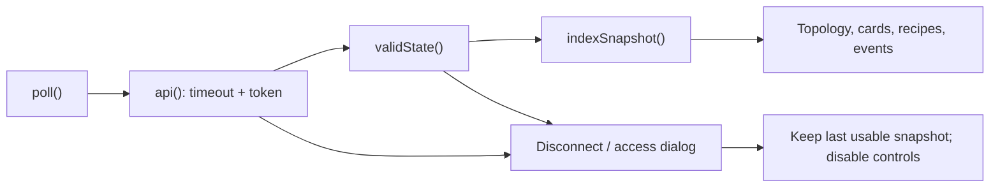

# Launchers, dashboard and topology lab

[Module map](README.md) · [Configuration](../configuration.md) · [API reference](../api.md)

## Entry points and process supervision

The `swarm` console script is declared in
[`pyproject.toml`](../../pyproject.toml) as `swarm.cli:main`.
[`__main__.py`](../../src/swarm/__main__.py) forwards `python -m swarm` to the same
function. [`__init__.py`](../../src/swarm/__init__.py) exposes the package version;
there is no background work on importing that module.

[`cli.py`](../../src/swarm/cli.py) owns launch configuration and local user-facing
commands. It does not implement rollout policy or arbitrary shell execution.
`parser()` builds the subcommands, and `main()` dispatches them to the relevant
Python module. Invalid arguments and operational failures produce an error and
nonzero exit status. `status --expect-agents` additionally fails if named peers
are missing or offline; an unhealthy app can still have an online agent.

`ProcessGroup` starts children using the current Python interpreter and an
argument list, not a shell. Child output is appended to named log files.
`wait_ready()` checks HTTP liveness and child exits during startup; `wait()`
watches for unexpected exits after launch. `_supervise()` handles Ctrl+C and
SIGTERM, then terminates children in reverse order and kills children that do
not exit within the shutdown allowance. It does not automatically restart them.

| Mode | Launched processes | Readiness and lifetime |
|---|---|---|
| `demo` | One coordinator, then an app and agent per endpoint. | Waits for coordinator/app `/health`; supervisor remains in the foreground. |
| `node` | One local app and one agent configured for a coordinator. | Waits for local app `/health`; the agent handles registration/reconnect. |
| `coordinator` | One Uvicorn server built by `coordinator.create_app()`. | Serves until interrupted. |
| `app` | One Uvicorn server built by `demo_app.create_app()`. | Binds to loopback; serves until interrupted. |
| `agent` | One asyncio endpoint loop. | Uses an already running local app; closes HTTP client and journal on exit. |
| `fault`, `repair`, `reset`, `status` | No supervised child fleet. | Performs the requested local operation or coordinator read, then exits. |

With `demo --include-incompatible` defaults, the supervisor has nine children:
one coordinator and four app/agent pairs. There are no VMs or containers. Device
labels say “Mac A” etc. for the story, while reported platform comes from the
actual host and registration mode is `simulated`.

`_agent_args()` keeps credentials in the inherited environment. The demo enables
optional local-model narration only for A and explicitly disables inherited
model settings for the other agents.

[`server.py`](../../src/swarm/server.py) is the separate Uvicorn development
entry point. Importing it creates the coordinator app using `SWARM_DB`,
`SWARM_TOKEN` and `SWARM_DEMO_MODE`. This does not start endpoints. Its environment
configuration and database default differ from the CLI; see
[configuration](../configuration.md). The CLI's LAN binding guard is not invoked
when Uvicorn imports `server:app` directly.

## Live dashboard

The coordinator serves [`index.html`](../../src/swarm/web/index.html) at `/` and
the web directory at `/static`. [`app.js`](../../src/swarm/web/app.js) is a plain
JavaScript closure with no build step. Its state comes from `GET /api/state`.

The request/render path is:

- `api()` attaches `X-Swarm-Token` when configured, uses an eight-second timeout,
  disables browser caching and converts HTTP/JSON failures into errors.
- `poll()` avoids overlapping polls. It schedules the next poll after completion:
  one second when connected, three seconds after a connection failure.
- `validState()` checks the rendering boundary, including optional evidence and
  eligibility. It is not a replacement for the complete Pydantic wire schemas.
- The accepted snapshot is indexed into maps for device names, current incident
  roles and recipe outcomes. Rendering reuses unchanged sections and preserves
  keyboard focus, expanded evidence panels and scroll state across updates.
- A malformed response or network failure leaves the last usable snapshot visible
  with a disconnected label and disables controls. It is not fresh telemetry.
- Authentication errors open the access dialog and suspend automatic data polls
  until credentials are supplied. The token is kept in tab `sessionStorage`, with
  an in-memory fallback if browser storage is unavailable.

`action()` sends a control POST and polls again. A successful POST means the
coordinator accepted the request; the endpoint may not have executed a queued
command yet. If the connection fails during a command, the UI reports an unknown
result and reconnects before allowing another command.

The live topology samples at most six agents, while counters and cards describe
the full snapshot. The event list displays up to forty entries from the snapshot.
Evidence panels show endpoint-reported summaries and original canary/follower
roles; only the newest recipe has a current eligibility preview. Required check
counts and checks actually attempted are separate concepts after early failure.

Native endpoint loopback app addresses are displayed as endpoint-local addresses:
`127.0.0.1` in another teammate's browser is not the remote endpoint. Local
rehearsal app links can be opened on the rehearsal host. Dynamic text is escaped;
app URLs are restricted to HTTP(S). These protections do not make an untrusted
registered URL a trusted service.

[`styles.css`](../../src/swarm/web/styles.css) defines the shared color tokens,
layout, mobile navigation and component states. Public design references are
recorded in [design.md](../design.md). Changes to DOM IDs or response handling
should be checked with both [Node and browser tests](../development.md).

## Synthetic topology lab

The `/mock` route serves [`mock.html`](../../src/swarm/web/mock.html), with its
own controller and styles. It does not load `app.js`, read the registry, send API
requests, or execute a repair. A synthetic count of 1,024 does not mean 1,024
endpoint processes are running.

[`mock-fleet-model.js`](../../src/swarm/web/mock-fleet-model.js) exposes
`SwarmMockModel` in the browser and CommonJS exports for Node tests:

| Function | Contract |
|---|---|
| `createFleet(count)` | Accepts 64, 256 or 1,024; returns deterministic nodes, contact lists and graph statistics. |
| `matchingPrefix(left, right)` | Counts the equal initial ID digits. |
| `route(fleet, sourceIndex, targetIndex)` | Returns a path of node indices using existing contacts and increasing target-prefix matches. |

IDs use a complete fixed-width base-4 space, with first-two-digit groups. Every
node has nearby ID neighbors plus contacts for alternative digits at each prefix
depth. For the supported sizes, routes take at most the ID width in hops. A
source equal to its destination has zero hops. The model assumes static,
reachable membership: health/offline colors do not remove nodes from routing.
It does not implement Pastry joins, churn, proximity selection or failure recovery.

[`mock-fleet.js`](../../src/swarm/web/mock-fleet.js) positions nodes in sixteen
radial groups and draws to Canvas. It shows a readable subset of peer contacts,
selected contacts and the computed route. The centered coordinator is a visual
control relationship, with sixteen grouped spokes, and is not a peer hop.
Counters count all generated directed contacts, not just visible edges.

Selection is available through Canvas clicks, source/destination menus and
keyboard-operable route-step buttons. Animation supports pause/resume/reset;
changing fleet size cancels the previous trace, and reduced-motion preferences
skip animation. No graph state is persisted. [`mock.css`](../../src/swarm/web/mock.css)
adds responsive layout and inspector styling using shared brand tokens.

## Benchmark utility

[`scripts/benchmark_fleet.py`](../../scripts/benchmark_fleet.py) seeds synthetic
registrations, incidents and outcomes into a temporary registry, checks the
canary gate, then launches an isolated coordinator and measures real loopback
HTTP requests. It reports errors, body sizes and latency percentiles, and shuts
down the service after the run. It does not launch or repair an app for each
synthetic peer. Read [scaling.md](../scaling.md) before using these measurements
in a presentation; the browser graph and HTTP benchmark answer different questions.
