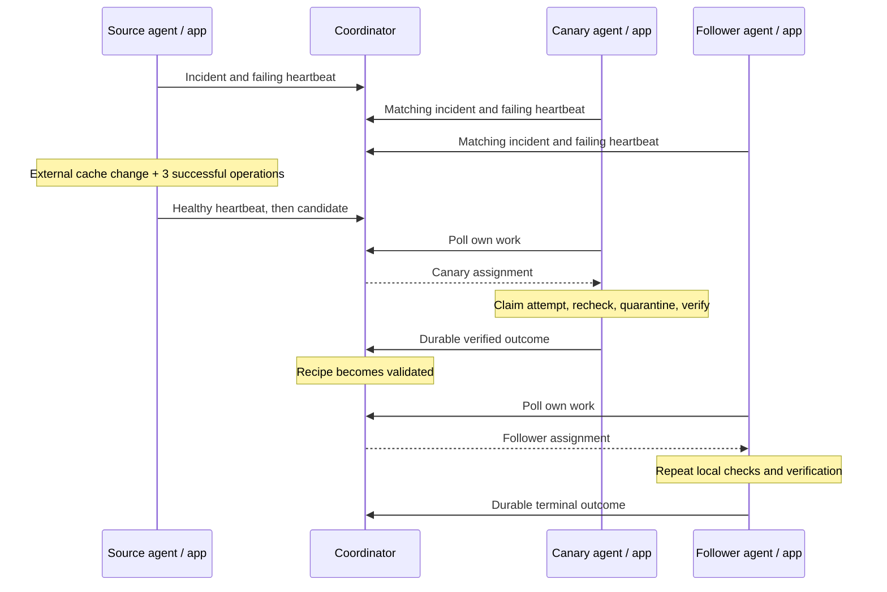
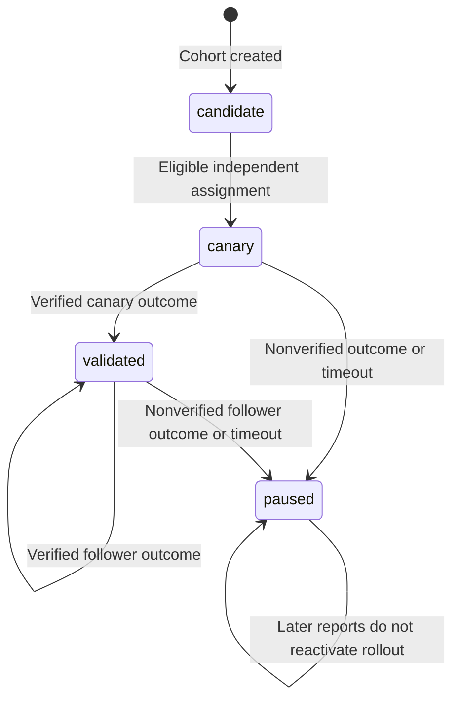

# The repair lifecycle

This walkthrough follows one real cache-corruption incident through SWARM.
The application, files, functional probes, HTTP reports and SQLite records are
real. In a single-machine rehearsal, the devices are separate app/agent processes
on one host. The `/mock` topology lab is a separate browser-only illustration and
does not participate in this lifecycle.

For commands and presentation steps, use the [demo runbook](demo-runbook.md).
For the functions behind each step, see [endpoint modules](modules/endpoint.md)
and [coordinator modules](modules/coordinator.md).

## Three different notions of health

| Signal | What it establishes |
| --- | --- |
| Application `GET /health` succeeds | The app process answers a liveness request. |
| Application `GET /work` succeeds | The app can read/validate its cache and complete the workspace operation now. |
| Agent heartbeat is recent | The coordinator heard from that endpoint within 30 seconds. |

A connected agent can report a broken application. Conversely, an offline agent
may have an app that is working locally. SWARM authorizes this scenario using
recognized functional failure and compatibility, not just connectivity.

## 1. Observe an actual failure

Fault injection writes invalid JSON to each targeted endpoint's own
`cache/workspace.json`. It does not toggle a dashboard-only status. The next
`/work` fails with `CACHE_INVALID`; `/health` can still succeed.

The agent records a local `functional_failure`, creates an `IssueReport` and
queues it for the coordinator. Its `issue_key` identifies the supported
application operation and error signature. Platform and app version are separate
compatibility metadata, so two devices may share an issue key while requiring
different repair cohorts.

Only a recognized cache error opens this incident type. An unreachable app or an
unrelated application error does not justify quarantining a cache.

## 2. Observe recovery on the source

A technician can rename the corrupted cache or run:

```bash
uv run swarm repair --data-dir .swarm/local/mac-a
```

The dashboard's **Simulate human repair** button instead queues a demo command
that performs this local quarantine on the selected endpoint. Both paths are
observed by the ordinary learner. The button is an explicit operator simulation,
not an autonomous learned repair.

The app regenerates an absent cache when `/work` runs. The agent must observe a
cache change after the failure and then three consecutive successful functional
probes. It samples before and after a probe so a manual edit during the HTTP call
is not lost. Expected missing-to-regenerated content from the probe itself is
not independently counted as a human change.

The learner associates that change with recovery and proposes the preinstalled
`quarantine_demo_cache` action. It does not know who changed the file, infer any
arbitrary repair command, or prove causality. Recovery without an observed change
does not create a candidate. Optional local-model narration can explain this
hypothesis but cannot change its action or authorization.

## 3. Admit a candidate and establish a cohort

The agent sends its fresh healthy heartbeat before flushing the candidate from
its durable outbox. The registry checks the recorded source incident, source
registration, matching environment, evidence references and recent healthy
status. Candidate contracts require at least three reported verification checks.

A recipe cohort is the combination of issue key, action, application ID, app
version and platform. Another candidate in the same cohort maps to the existing
recipe; it does not create another independent rollout or unpause a failed one.

The coordinator shares bounded evidence summaries and references. Those are
endpoint reports, not independently authenticated proof. Candidates currently
carry up to three summaries: failure, change and recovery.

## 4. Select one independent canary

An endpoint polls for its own work. The registry atomically chooses one eligible
endpoint as canary and changes the recipe from `candidate` to `canary`. Selection
depends on eligible polling order; B or C can be chosen in the four-device demo.

Fresh assignments require a recent unhealthy endpoint with a matching incident
and matching platform, application ID and app version. The source incident is
excluded: it cannot validate itself. An incompatible device gets no assignment.
Other compatible peers wait for the canary result.

The dashboard's eligibility list explains current decisions for the newest
recipe using the same policy predicate as dispatch. Looking at that preview does
not reserve a canary or authorize an endpoint mutation.

## 5. Recheck and execute at the canary

Before touching files, the agent records an executing attempt for the assignment
ID. It then checks the assignment's endpoint and incident IDs, known issue,
compatible environment, unpaused recipe and supported action. The cache must
still be invalid; a fresh `/work` must reproduce `CACHE_INVALID`; the cache
fingerprint must remain unchanged across that probe.

Only then does it atomically move the cache to
`quarantine/<assignment-id>.json`. Three consecutive successful `/work` probes
are required for `verified`. The first failed or unreachable probe stops the
verification loop.

Each attempt records available precondition, action, verification and rollback
observations. The terminal outcome and its outbox item are committed together.
The summary's `checks_total` records probes actually attempted; the outcome's
default total of three represents the required verification count. A failure on
the first probe therefore shows `0/1` attempted in evidence and `0/3` required in
the outcome.

## 6. Propagate after verified recovery

The coordinator accepts an outcome only for its issued endpoint, assignment,
recipe and incident. A verified canary validates the recipe. Compatible peers
can then receive follower assignments and perform the same local rechecks,
quarantine and verification. Followers are not constrained to one-at-a-time
execution.

The source is excluded for its original incident. If it later develops a new
matching incident, an independently validated recipe can be replayed there too.
This is incident-specific deduplication, not permanent exclusion of a device.



## Failure, rollback and pause

An invalid precondition rejects the assignment before mutation. Failed
verification after quarantine attempts rollback. Restoration is allowed only
when the current cache is absent or equals the app's known regenerated default.
If a human has made a different edit, SWARM preserves both that current cache and
the quarantine backup and reports failed rollback for inspection.

Any accepted nonverified outcome—`failed`, `rejected` or `inconclusive`—pauses the
recipe. A follower failure can therefore stop further propagation too. A later
successful result from already-running work does not silently unpause it.



This diagram describes recipe states. Global pause is a separate coordinator
flag: it holds new and pending repair delivery but still allows observation,
reporting and demo commands. Work already executing may finish. Global resume
does not reset a failed recipe's `paused` state.

## Retry, restart and reset

| Situation | Current behavior |
| --- | --- |
| Outcome response is lost | The endpoint resends the saved outcome; it does not execute the assignment again. Identical terminal reports are deduplicated by the coordinator. |
| Agent restarts during execution | The unfinished local attempt becomes `inconclusive`; automatic replay stops. The learning baseline is refreshed so its own mutation is not relearned. |
| Coordinator is unavailable | Observation continues locally. Reports wait in the outbox; the agent does not receive permission for a new repair. |
| Assignment expires | The coordinator records an inconclusive outcome and pauses the recipe. The default deadline is 120 seconds; expiration is processed by registry operations, not a separate timer service. |
| A late result conflicts with expiry/reset | The coordinator rejects it. The agent records terminal delivery rejection locally rather than retrying that item forever. |
| Reset is requested | Shared incident/recipe/assignment/outcome history is cleared, registrations remain, and reset commands are queued for endpoints. |

An endpoint reset restores the known cache, clears transient learning state and
pending deliveries, and preserves identity, local observations, completed-command
history, repair-attempt deduplication and quarantine files. The coordinator blocks
new incident/candidate submissions from each endpoint until its reset succeeds.
A failed reset acknowledgement keeps that barrier in place; fix the local cause
and request a new reset. Reset is not instantaneous for offline devices.

Useful investigation keys are `agent_id` for the endpoint, `incident_id` for one
failure episode, `candidate_id` for a proposal, `recipe_id` for its shared cohort,
`assignment_id` for one execution, and `evidence_id` for a local observation.
See [data and state](data-and-state.md) and the [API reference](api.md) for their
stored and transmitted forms.

Verification is a short observation window, not proof of permanent resolution.
Long-term recurrence tracking and broad operating-system repairs remain future
work. The [development guide](development.md) describes how to extend the
implementation without bypassing these checks.
